<!-- Animated header banner -->

  

  

  
  
  
  

---

###  `whoami`

  

###  Highlights

-  **IEEE paper @ CSNet'26** — integrated **ML-KEM-768** post-quantum key exchange into Signal Desktop ([Signal-PQC-Integration](https://github.com/Somthin2/Signal-PQC-Integration)); journal version submitted to MDPI
-  Actively hunting real vulnerabilities on **HackerOne** and **Intigriti**
-  Ex-**Cybersecurity Analyst** — ran large-scale SIEM operations and built phishing-simulation infrastructure from scratch
-  Completed all **52 PortSwigger** Server-Side Vulnerabilities labs
-  Ranked **241 / 1,200** in a HackTheBox CTF
- 🇸🇪 Erasmus+ programme in Sweden focused on information security

###  Toolkit

  
  
  
  
  
  
  
  
  
  
  

###  Featured Work

| Project | What it is |
|---|---|
| 🔐 [**Signal-PQC-Integration**](https://github.com/Somthin2/Signal-PQC-Integration) | Post-quantum cryptography (ML-KEM-768) in Signal Desktop — IEEE CSNet'26 |
| 🎭 [**AthanasiosPortfolio**](https://github.com/Somthin2/AthanasiosPortfolio) | My Phantom-Thief-themed portfolio — [live here](https://somthin2.github.io/AthanasiosPortfolio/) |

###  Open to

Graduate cybersecurity roles, security research, and part-time IT / security work in **Klagenfurt** or remote across **Austria / EU**.

###  Contribution Hunt

  <picture>
    <source media="(prefers-color-scheme: dark)" srcset="https://raw.githubusercontent.com/Somthin2/Somthin2/output/github-snake-dark.svg" />
    <source media="(prefers-color-scheme: light)" srcset="https://raw.githubusercontent.com/Somthin2/Somthin2/output/github-snake.svg" />
    
  </picture>

---

  
  <i>"The best thing about a boolean is even if you are wrong, you are only off by a bit."</i>

  

